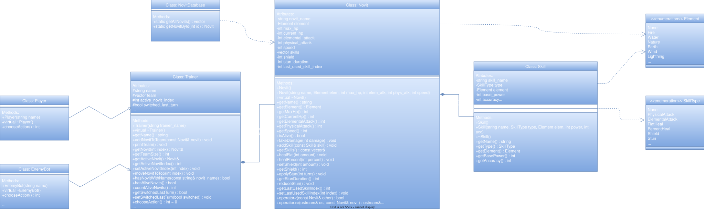

# Novits: The Lost Species

A console-based 4v4 turn-based tactical game written in C++ as an Object-Oriented Programming course project. The game is inspired by classic monster-battling games like *Miscrits* and *Pokémon*.

## 1. Game Features & Mechanics

* **Two Game Modes:**
  * **Player vs Bot (Singleplayer):** Battle against an AI opponent (`Novit's Master (AI)`) that randomly drafts a team of 4 unique Novits and selects valid moves during combat (avoiding healing skills when at full HP).
  * **Player vs Player (Local 1v1 on one screen):** Two players enter their custom nicknames, draft their teams, and play against each other in hot-seat mode.
* **4v4 Draft Phase:** Players choose 4 unique Novits from a roster of 18 creatures divided into 6 elements (3 Novits per element). Picking duplicate Novits within the same team is blocked.
* **Elemental System:**
  * **Cycle 1:** Fire > Nature > Water > Fire
  * **Cycle 2:** Earth > Lightning > Wind > Earth
  * Hitting an elemental weakness deals **1.5x** damage (*Super Effective*), while hitting a counter deals **0.5x** damage (*Not Very Effective*). Same-element and neutral hits deal normal **1.0x** damage.
* **Skill Types:** Each Novit has 4 skills chosen from:
  * `PhysicalAttack` – scales with the attacker's Physical Attack (`PHYS`).
  * `ElementalAttack` – scales with Elemental Attack (`ELEM`) and elemental multipliers (`0.5x`, `1.0x`, `1.5x`).
  * `FlatHeal` & `PercentHeal` – restores a fixed amount or a percentage of Max HP.
  * `Shield` – grants a barrier that absorbs incoming damage before HP is reduced.
  * `Stun` – stuns the target for **2 turns**, causing it to skip its actions.
* **Dynamic Turn Queue & Speed Advantage:**
  * Turn order is determined dynamically by comparing the active Novits' `SPD` stats.
  * The active Novit is always at the top of the team queue (`team[0]`).
  * When an active Novit faints (`0 HP`), it is automatically moved to the bottom of the list and the next alive Novit in line enters the battle.
  * Manually switching a Novit (`[5] Switch Novit`) puts the chosen creature at the top of the list and moves the previous one to the bottom (clearing any active stun on it). If a player switches into a slower Novit, the faster opponent can gain a **2nd turn in a row**.
* **Anti-Spam Rules & Surrender:**
  * A Novit cannot use the exact same skill twice in a row.
  * A trainer cannot switch Novits two turns in a row.
  * Typing `ff` (or `FF`) during action selection allows a player to surrender the match immediately.

## 2. Project Architecture & OOP Concepts

The project is divided into header (`.h`) and implementation (`.cpp`) files inside the `Novits/` directory:

* **`Skill` (`skill.h`, `skill.cpp`):** Stores move attributes (`skill_name`, `SkillType`, `Element`, `base_power`, `accuracy`) and provides `const` getters. Also defines the `Element` and `SkillType` scoped enums (`enum class`).
* **`Novit` (`Novit.h`, `Novit.cpp`):** Represents a creature with its combat stats (`max_hp`, `current_hp`, `elemental_attack`, `physical_attack`, `speed`), status effects (`shield`, `stun_duration`), anti-spam tracker (`last_used_skill_index`), and a composition of 4 `Skill` objects (`std::vector<Skill>`).
  * **Operator Overloading:**
    * `operator<` compares two Novits by their `speed` stat to determine turn initiative.
    * `operator<<` formats and prints the Novit's summary (name, HP, SPD, and active shield) at the end of the battle.
* **`NovitDatabase` (`novitdatabase.h`, `novitdatabase.cpp`):** A static factory class (`getAllNovits()`, `getNovitById(int id)`) that configures and returns all 18 Novits and their skillsets.
* **`Trainer` (`trainer.h`, `trainer.cpp`):** An abstract base class managing the trainer's `name`, `team` vector (`std::vector<Novit>`), queue rotation (`moveNovitToTop`), switch cooldown flag (`switched_last_turn`), and the pure virtual method `virtual int chooseAction() = 0`.
* **`Player` & `EnemyBot` (`player.h/cpp`, `enemybot.h/cpp`):** Derived classes inheriting from `Trainer`. Both override `chooseAction()` to implement runtime polymorphism via base class pointers (`Trainer* player`, `Trainer* bot`) in `main.cpp`.
* **Exception Handling:** Uses `try`, `throw`, and `catch (const std::exception& e)` blocks with `std::invalid_argument`, `std::out_of_range`, and `std::logic_error` to validate console input during mode selection, team drafting, switching, and combat actions.

### UML Class Diagram



## 3. How to Compile and Run

### Option 1: Using Code::Blocks (Recommended)

1. Clone or download this repository.
2. Open the project file `Novits/Novits.cbp` in **Code::Blocks**.
3. Press **F9** (*Build and run*) to compile and start the game.

### Option 2: Using g++ in Terminal

Navigate to the `Novits/` folder and compile all `.cpp` files:

```bash
cd Novits
g++ -std=c++11 main.cpp Novit.cpp novitdatabase.cpp player.cpp enemybot.cpp trainer.cpp skill.cpp -o Novits
./Novits
```

## 4. Gameplay Example

### Mode Selection & 4v4 Draft

```text
========================================================================
                      NOVITS: THE LOST SPECIES                          
========================================================================

[1] Player vs Bot
[2] Player vs Player (1v1 on one screen)

Choose mode (1-2): 1
Enter Player 1 nickname: Maciej

========================================================================
                  NOVITS: THE LOST SPECIES - 4v4 DRAFT                  
========================================================================

[1] Ranwey (Fire)                   [2] El Flame (Fire)                 
[3] Sentow (Fire)                   [4] MinM (Water)                    
[5] Focean (Water)                  [6] J-Sea (Water)                   
[7] Skinniest J (Nature)            [8] Dr. Tree (Nature)               
...
========================================================================
Maciej, pick Novit #1 (enter ID 1-18): 1
>> Added Ranwey to Maciej's team!
```

### Combat Screen

```text
========================================================================
                 NOVITS: THE LOST SPECIES (4v4) - TURN 2
========================================================================

[P1] Maciej (Alive: 4/4)            |   [P2] Novit's Master (AI) (Alive: 4/4)
------------------------------------+-----------------------------------
Novit: Ranwey (Fire)                |   Novit: OutGrass (Nature)
HP: [##########] 115/115            |   HP: [######....] 66/120
PHYS: 10 | ELEM: 14 | SPD: 48       |   PHYS: 12 | ELEM: 14 | SPD: 45
Status: OK                          |   Status: OK
========================================================================
 [ LAST TURN ]
  >> Ranwey uses [Firye]! Deals 54 elemental damage to OutGrass! [SUPER EFFECTIVE! x1.5]
========================================================================

--- Your Team ---
[1] Ranwey (Fire | HP: 115/115) [ACTIVE]
[2] MinM (Water | HP: 100/100)
[3] Dr. Tree (Nature | HP: 125/125)
[4] Eisidisi (Lightning | HP: 90/90)

--- Ranwey's Actions ---
[1] Edur (Physical Attack | Power: 15 | Acc: 100%)
[2] Firye (Elemental (Fire) | Power: 22 | Acc: 95%) [LOCKED - Used last turn!]
[3] YeYe (Flat Heal: +25 HP | Acc: 100%)
[4] 4th Dimension (Shield: +30 | Acc: 100%)
[5] Switch Novit
[ff] Surrender (Forfeit match)
Maciej, choose your action (1-5 or ff): 
```